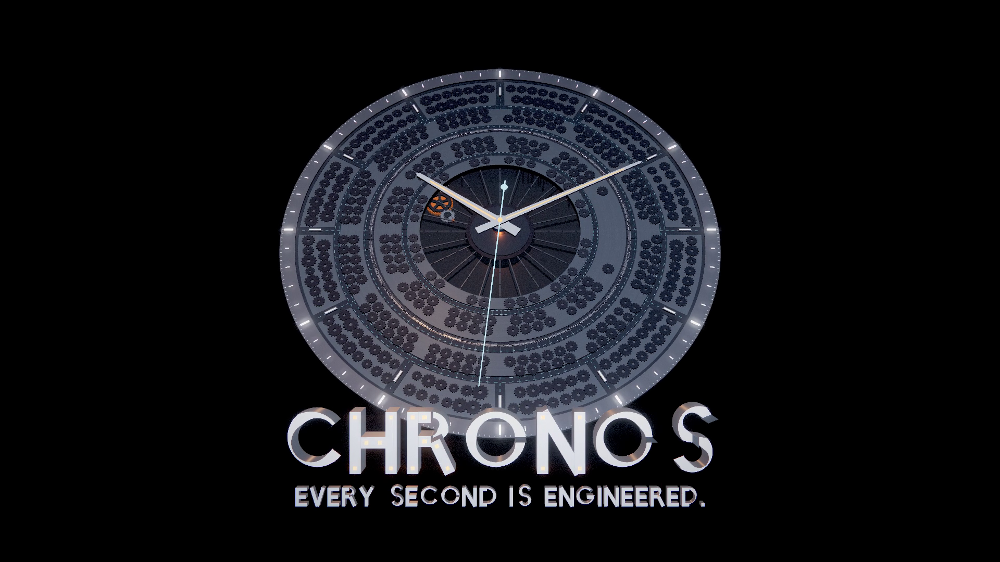

# CHRONOS — The City That Manufactures Time



A 30-second procedural motion-design film. Everything on screen is generated in code: the gear train and its
meshing phases, the city and its assembly choreography, the kinetic typography (a stroke typeface built from
mechanical bars), the armillary core, the energy wave, and the transformation of the whole metropolis into a clock.

- 1920×1080, 16:9, 30 fps, ~30 s
- Deterministic: every frame is a pure function of time, so the real-time player and the offline renderer show
  exactly the same film
- Rendered offline with temporal supersampling (motion blur + anti-aliasing), then encoded to H.264 MP4

## Files

| Path | What it is |
|---|---|
| `index.html` | Real-time player (space pause · ← → scrub · R restart · F fullscreen). Query: `?t=12` start time, `?paused=1`, `?loop=0`, `?dpr=1` |
| `src/film.js` | Orchestration: camera choreography, lighting by act, post parameters, temporal sampling |
| `src/timeline.js` | Every beat (seconds) and world dimension in one place — retime the film here |
| `src/world/plate.js` | The foundation: base plate, glass annulus, under-plate structure, the exact-meshing gear train |
| `src/world/city.js` | Towers (assembly, pistons, windows), ring streets, bridges, elevated tracks, trains, vehicles, bezel |
| `src/world/hero.js` | The skyscraper that unfolds into gears → transport loops → streams of numerical data |
| `src/world/sphere.js` | The glass sphere, iris, armillary core (rings, pieces, pulses, beams), alignment and release |
| `src/world/clock.js` | Hands, hour indices, chapter ring, the orange pulse and the single tick |
| `src/world/text.js` | Kinetic typography: bars that slide, converge, scan and align anamorphically |
| `src/typeface.js` | The geometric stroke typeface (lines and arcs on a 1000-unit em) |
| `src/geometry.js` | Procedural geometry: gears, arc bars, annuli, tapered hands |
| `src/materials.js` | Analytic studio environment (no texture lookups), procedural windows and panel seams, per-instance glow, height AO |
| `src/post.js` | HDR pipeline: accumulation, dual-Kawase bloom, anamorphic streak, god rays, ACES composite with grade, vignette, chromatic aberration, grain |
| `src/camera.js` | Keyframed camera with non-uniform Hermite paths, easing and hard cuts |
| `render/render.mjs` | Offline renderer → MP4 (headless Chromium + ffmpeg) |
| `render/stills.mjs` | Still frames and contact sheets for review |
| `vendor/three.module.js` | three.js r160 (the only dependency) |

## Run the player

Serve the folder with any static server (ES modules need http), then open `index.html`:

```
npx serve .        # or: python3 -m http.server 8000
```

## Render the MP4

Requires Node 18+, Playwright (with its Chromium) and ffmpeg on the PATH.

```
npm i playwright
node render/render.mjs --out chronos.mp4 --fps 30 --samples 3 --shutter 0.5
node render/stills.mjs --times 2.9,10.3,14.3,19.3,27 --w 1920 --h 1080 --out stills
```

`--samples N` renders N sub-frames across the shutter interval (`--shutter` is the fraction of the frame period,
0.5 = 180°) and averages them in a float buffer: physically plausible motion blur plus anti-aliasing. Without a GPU
(SwiftShader) a full 1080p render takes a while; use `--w 640 --h 360 --samples 1` for a quick preview.

## Timeline

| Time | Beat |
|---|---|
| 0–4 s | The first second: a tiny orange gear, the cascade of engagement, the pull-back through the foundation. *TIME IS NOT FOUND.* |
| 4–9 s | The city awakens: towers assemble, bridges rotate in, tracks extend, trains and streets move. *IT IS BUILT.* (anamorphic) |
| 9–15 s | Complexity: a skyscraper unfolds into gears, gears become transport loops, loops become data wrapping the sphere |
| 15–21 s | The hidden system: through the iris into the core; acceleration, alignment, a moment of stillness, the release |
| 21–27 s | The transformation: the city folds inward and locks into a clock |
| 27–30 s | CHRONOS: one tick of the second hand, a pulse of orange light, the title |
