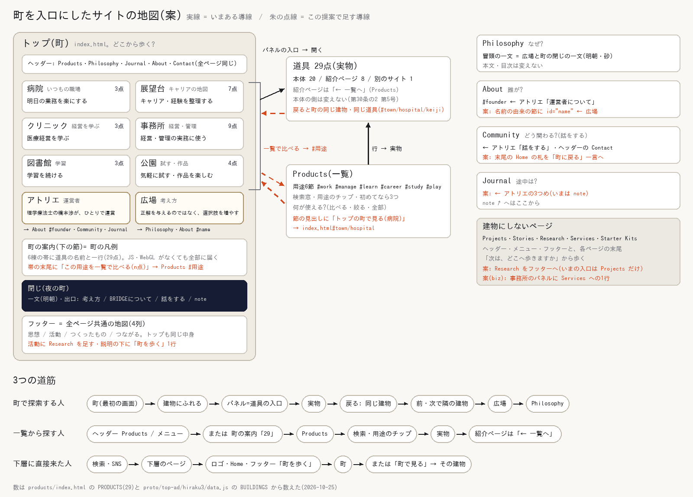
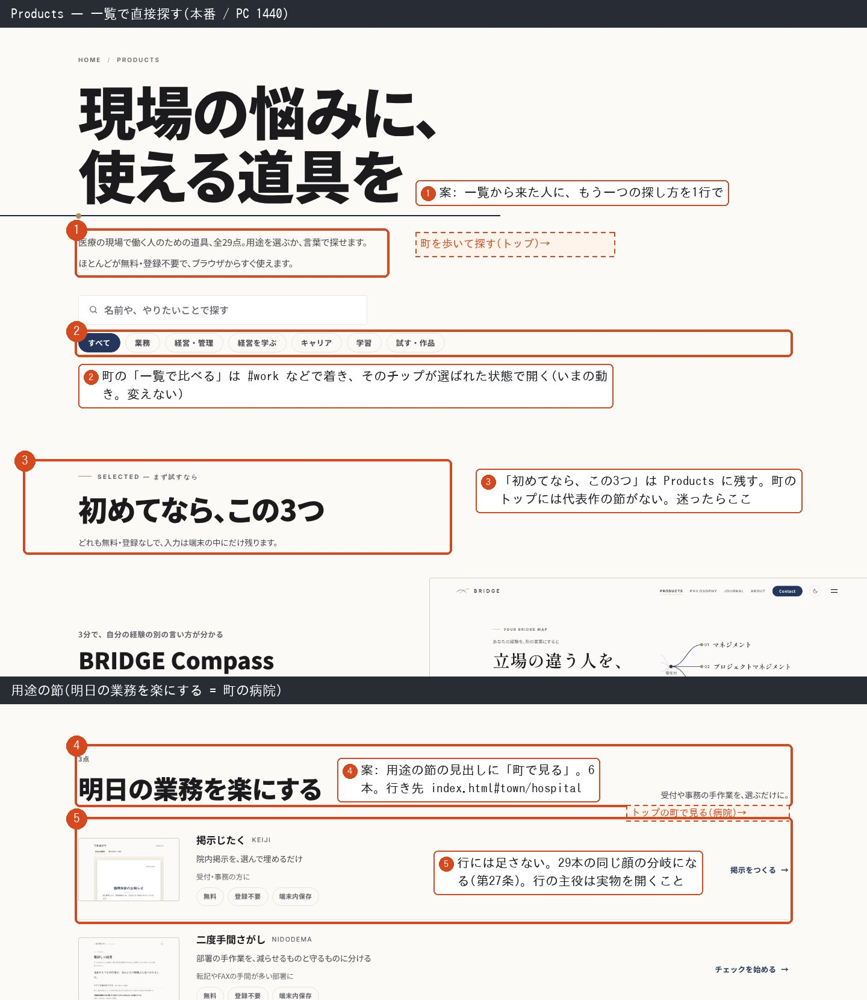
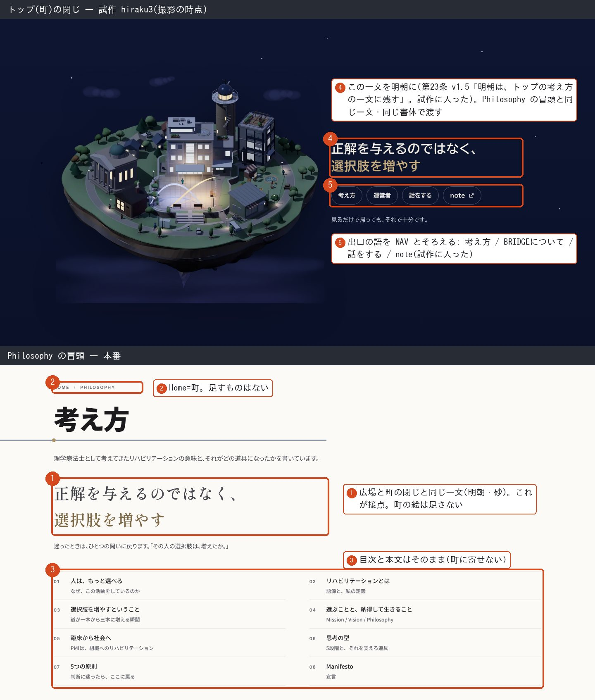
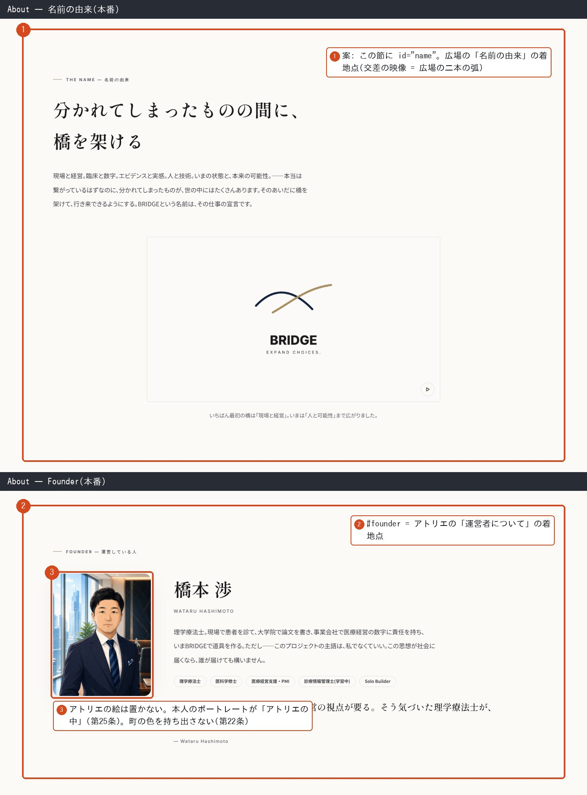
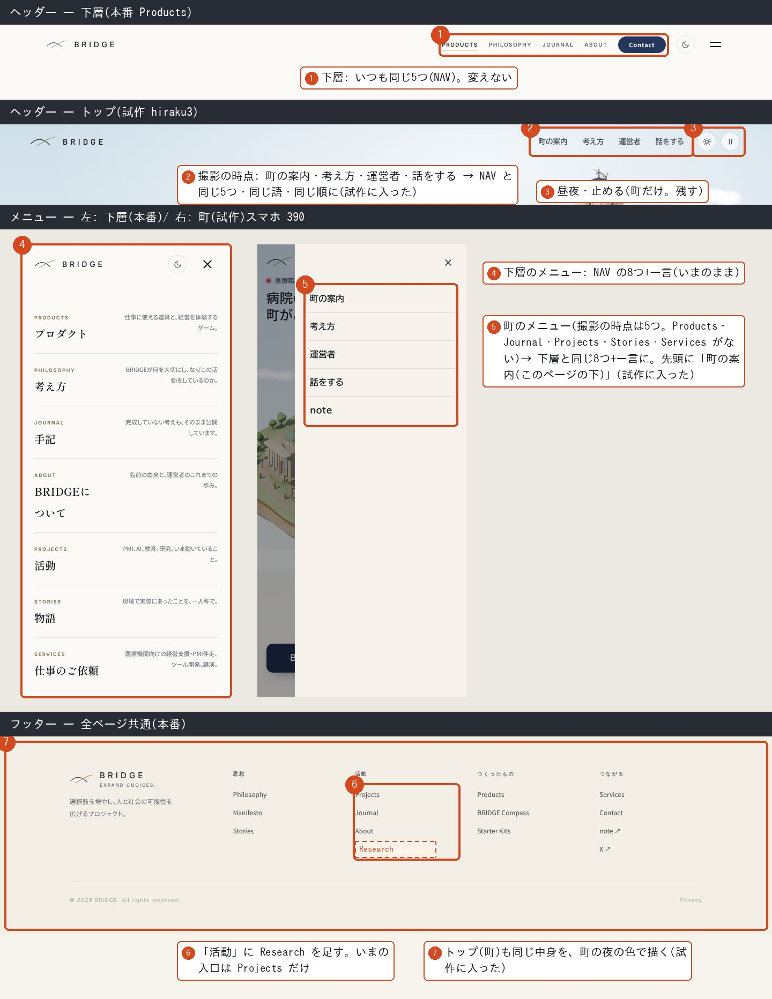
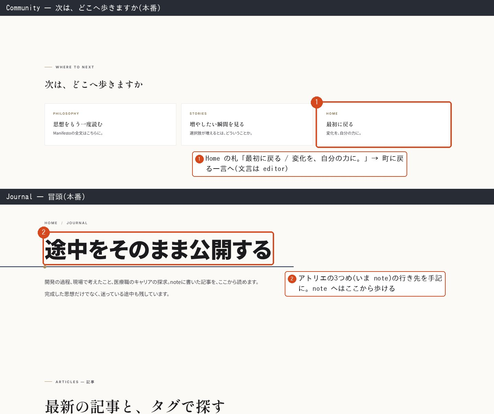
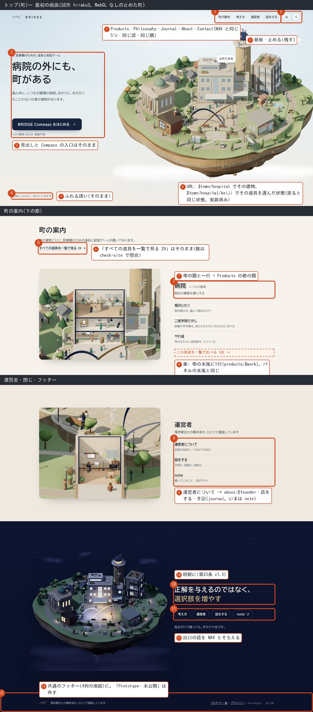
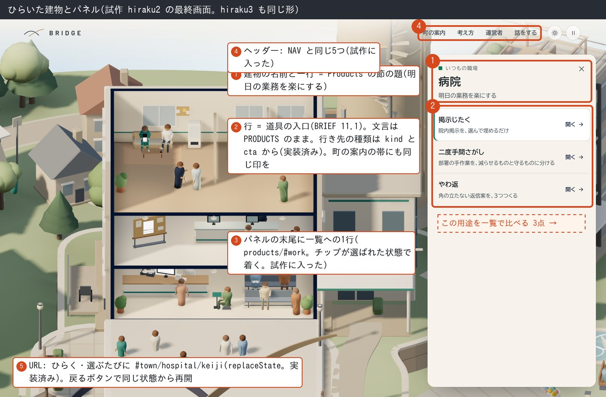

# 町を入口にしたサイトの導線(情報設計の提案)

2026-10-25・情報設計の担当(BRIEF §11.5)。`docs/ia.md` v3.3 を土台にした提案。本番のページ・`shared/`・`docs/` は変えていない。
同日改(designer の照合を受けて): Products のヒーローと節の「町で見る」、下層フッターの「町を歩く」、一文が移るビュー遷移を見送った。写しの扱い(g)と、社長の判断が要ることを並べ直した。
画面は 2026-10-25 にローカルで撮った本番と試作 `hiraku3`(撮影の時点。WebGL なし=止めた町)。ひらいた状態だけ `hiraku2` の最終画面。撮った全画面は現場の作業領域(scratchpad の `ad-hiraku3/ia/shots/`)に置き、リポジトリには入れていない。

## 0. 実物から数えたこと(提案の前に読んだ時点)

- 道具は29点(`products/index.html` の PRODUCTS)。用途6つは 業務3・経営管理9・経営を学ぶ3・キャリア7・学習3・試す作品4。町の6棟(`data.js` の BUILDINGS)と1対1で、数も同じ。ほかにアトリエ3と広場1
- 行き先の種類は 本体20・紹介ページ8・別のサイト1
- NAV(`shared/bridge.js`)は7項目+CTA(話をする)。ヘッダーに常に出るのは Products・Philosophy・Journal・About と Contact。メニューは8項目と一言。フッターは4列13リンクと Privacy
- 下層9ページ(Products・Projects・Philosophy・About・Community・Research・Journal・Stories・Services)は同じ骨組み: 固定ヘッダー → `.page-hero`(Home / ページ名)→ 本文 → 「次は、どこへ歩きますか」3分岐 → 共通フッター
- Research は NAV にもフッターにもない。入口は Projects の中の3か所だけ
- 町の試作は `bridge.js` を読まない(計測の GoatCounter と利用ログが動かない)。読んだ時点のヘッダーは4項目(町の案内・考え方・運営者・話をする)、メニューは5項目、フッターは1行で、トップから Journal・Projects・Stories・Services・Research・Starter Kits・X へ歩けなかった。ヘッダーは最初の画面と一緒に流れて消え、下の節(約4,800px)ではナビに届かなかった
- `scripts/check-site.mjs` 6項は、いまのトップの文言(「ぜんぶで29点あります」・「目的から探す」の行・クリニックタウン3D の版)を照合する。町に置き換えると、6項の書き直しが要る
- その後、操作と画面の担当が、ヘッダー・メニュー・フッター・下の節の固定ヘッダー・閉じの明朝・「一覧で比べる」・アトリエの行き先・`#town/建物/道具` を試作に入れた(f の [x])

## 1. ページの役割と、町との対応(いま)

| ページ | 問い(ia.md §2) | 主な入口 | 末尾の3分岐 | 町との対応 |
|---|---|---|---|---|
| トップ(町) | 定義なし(案: どこから歩く?) | 直接・検索 | 閉じの出口4つ | 町そのもの |
| Products | 何が使える? | ヘッダー・フッター・7ページの末尾・LP の「← 一覧へ」 | Philosophy / note / Community | 6棟 = 6節(同じ語・同じ数) |
| Philosophy | なぜ? | ヘッダー・8ページの末尾 | Projects / Stories / Contact | 広場(同じ一文) |
| About | 誰が? | ヘッダー・Services の末尾 | Philosophy / Projects / Community | アトリエ(人)・広場(名前の由来) |
| Community | どう関わる? | ヘッダーの Contact・5ページの末尾 | Philosophy / Stories / Home | アトリエ(話をする) |
| Journal | 途中はどうなってる? | ヘッダー・Projects と Research の末尾 | Philosophy / Products / Community | アトリエ(手記) |
| Projects | いま何を? | メニュー・フッター・3ページの末尾 | Products / Research / Journal | なし |
| Research | 確かめたのか? | Projects だけ | Projects / Journal / Philosophy | なし |
| Stories | 何が変わる? | メニュー・フッター・4ページの末尾 | Philosophy / Products / Contact | なし |
| Services | 定義なし | メニュー・フッター・Starter Kits の末尾 | Stories / Products / About | なし(案: 事務所に1行) |

## a. 町を入口にしたサイトの地図

| 建物 | 用途 = Products の節 | 道具 | パネルの末尾 |
|---|---|---|---|
| 病院 | 明日の業務を楽にする `#work` | 3 | この用途を一覧で比べる → `products/index.html#work` |
| 展望台 | キャリア・経験を整理する `#career` | 7 | 同 `#career` |
| クリニック | 医療経営を学ぶ `#learn` | 3 | 同 `#learn` |
| 事務所 | 経営・管理の実務に使う `#manage` | 9 | 同 `#manage`(Services への1行は biz の判断) |
| 図書館 | 学習を続ける `#study` | 3 | 同 `#study` |
| 公園 | 気軽に試す・作品を楽しむ `#play` | 4 | 同 `#play` |
| アトリエ | 運営者 | 運営者について → `about/index.html#founder`・話をする → `community/`・手記 → `journal/` | — |
| 広場 | 考え方 | 考え方 → `philosophy/`・BRIDGEについて → `about/`(名前の由来に id を足したら `#name`)・8棟の一覧(BRIEF §11.3) | — |

- **建物にしないページ:** Projects・Stories・Research・Services・Starter Kits。町は「道具・考え方・人」の3層で足りる。記録や依頼まで建物にすると、町が索引に戻る(BRIEF §9 の社長評価「カテゴリーの一覧に見える」)。共通のヘッダー・メニュー・フッターと、各ページの末尾から歩く
- **探索する人:** 町 → 建物 → パネル(道具の入口)→ 実物 → 戻る(同じ建物・同じ道具)→ 前・次で隣の建物 → 広場 → Philosophy → 末尾の3分岐
- **一覧から探す人:** ヘッダーの Products(PC)/メニューの Products(スマホ)/町の案内の「すべての道具を一覧で見る 29」→ Products → 検索・チップ → 実物。建物から来た人は `#用途` で、そのチップが選ばれた状態で着く(いまの動き)
- **下層に直接来た人:** ロゴとパンくずの Home → 町。下層の側に町への道は足さない(Home への道は1本で足りる)

## b. トップ(町)と Products の線引き

町は「出会う」(場所で、ひとつずつ)。Products は「選ぶ」(全部を並べて、比べて、絞る)。

| | トップ(町) | Products |
|---|---|---|
| 問い | どこから歩く? | 何が使える? |
| 並べ方 | 建物(場所) | 用途の節(同じ6つ・同じ語) |
| 道具の情報 | パネルで1つずつ(写し1枚・名前・一行・誰向け・利用条件・行き先の種類・ボタン。BRIEF §11.1) | 全行に名前・一行・誰向け・利用条件・ボタン |
| 探し方 | ふれる・前/次・広場の見晴らし | 検索窓・用途のチップ・ハッシュ |
| 迷った人へ | 最初の画面の Compass | 初めてなら、この3つ |
| 持たないもの | 検索・チップ・全件の比較 | 町の絵・建物の名前・町への道 |

- **町の案内(下の節)は町の凡例。** JS・WebGL がなくても29点に届く保証(BRIEF 9.7)。名前と一行と行き先の種類にとどめ、誰向け・利用条件・検索は足さない(足せば Products の写しになる)。並びは町の順のままでよい(語と数が同じなので迷わない)
- **道は町から Products への1本。** 町の案内の帯とパネルの末尾の「この用途を一覧で比べる(n点)」→ `products/index.html#work` など。Products から町へは、ロゴとパンくずの Home で足りる。Products のヒーローは、リードの下の最初の一歩を「探す」に使っている(design-system §4 Page opening)。節や行に「町で見る」を足すと、同じ顔の繰り返しで一覧の密度が上がる
- **データは PRODUCTS が唯一の情報源。** 町の TOOLS はいま写しなので、本番化までは check-site で照合し、本番化で PRODUCTS から作る(f)

## c. ヘッダー・メニュー・フッター

| 部品 | 役割 | トップ(町) | 下層 |
|---|---|---|---|
| ヘッダー | いつも同じ5つの行き先と現在地 | NAV と同じ5つ・同じ語・同じ順。町だけの昼夜・止める。下の節でも届く(最初の画面を過ぎたら固定) | 変えない |
| メニュー | 全ページの地図(8つと一言) | NAV と同じ8つと一言。先頭に「町の案内(このページの下)」 | 変えない |
| フッター | 最後にもう一度、地図 | 同じ4列を町の夜の色で | 「活動」に Research |
| 末尾の3分岐 | そのページの文脈で選ぶ | 閉じ(夜の町)の出口がこれに当たる | 変えない(Community の Home の札だけ言い換え) |

- 見た目(書体・色・昼夜)は町のもの。行き先・順・語は共通で、`bridge.js` の NAV から描く(唯一の情報源のまま)。本番では `bridge.js` を読み、部品もトークンも足さない
- ヘッダーの語は NAV.en(Products・Philosophy・Journal・About・Contact)。町で「考え方」と書いた入口が、次のページでは「PHILOSOPHY」になる。小さいが、移るたびに起きる違和感
- 「町の案内」は同じページの中への道なので、ヘッダーから外し、メニューの先頭とスキップリンクに置く
- 下層のヘッダーとフッターに町への道は足さない。ロゴとパンくずの Home が町へ行く。フッターに足すと Home への2本目になり、名前がいまのトップの絵に結びつく(トップを作り直すたびに全ページのフッターの語が変わる)

## d. 町から通常のページへの接点

見た目は寄せない。言葉・行き先・線(ロゴ)でつなぐ。町の絵は町の外へ持ち出さない。

| 接点 | どこ | なぜ違和感がないか |
|---|---|---|
| 1 パネルが前室 | 町のパネル | 町 → 生成りの紙のパネル → 紙のページと、少しずつ通常のページに近づく。文言は PRODUCTS と各ページの語のまま |
| 2 同じ一文 | 広場・町の閉じ → Philosophy の冒頭 | 「正解を与えるのではなく、選択肢を増やす」が両端にある。閉じの一文は明朝(第23条 v1.5)なので、書体ごと同じ一文で迎えられる |
| 3 名前の由来 | 広場 → About の名前の由来 | 広場の二本の弧 = ロゴ = About の「交差」の映像。同じ形を、町では立体、About では線で見る |
| 4 人 | アトリエ → About `#founder` | アトリエの机の一人から、本人のポートレートへ。比喩から本人に移る |
| 5 同じ用途の語 | 建物の一行 → Products の節の題 | 「明日の業務を楽にする」が両方の見出し。着くとチップが選ばれている |
| 6 戻ると同じ状態 | 町の URL `#town/hospital/keiji` | 戻るボタンで同じ建物・同じ道具に戻る(第27条: 選択に世界が応答する) |
| 7 共通のフッター | 町の閉じの下と全ページ | 町の最後が、どのページにもある同じ地図で終わる。その先は通常のページ |

やらないこと:
- 下層の書体・色・ヘッダーを町に寄せない(第30条の2 と同じ考え方。つなぐのは体験と言葉)
- Philosophy に広場の絵、About にアトリエの絵を置かない。About には本人のポートレートがある
- Products に町への道を足さない。ヒーローはリードの下の一歩が「探す」の1つ(Page opening)、節と行は同じ顔の繰り返しになる(第27条)
- 下層のフッターに「町を歩く」や小さな町の地図を置かない。Home への2本目になり、語や絵がいまのトップに結びつく
- 一文が移るビュー遷移はしない。夜の帯から明るい地へ移るので、地の色と文字の大きさが飛ぶ。同じ一文があるので足りる
- Stories を病院のパネルに入れない。パネルは道具(使う)の入口で、読むものを混ぜると役割がぼける

## e. トップ以外のページの改善案

本番のコードは変えていない。番号は画像の番号。

### Products

1. 用途のチップとハッシュ(`#work` など)はそのまま。町の「この用途を一覧で比べる」の着地点
2. ヒーローに町への道は足さない(リードの下の最初の一歩は「探す」の1つ)
3. 町へ戻るのはロゴとパンくずの Home で足りる
4. 「初めてなら、この3つ」は残す。町のトップには代表作の節がない。上のコメント(トップの主ボタン・副導線と同じ選定)は前提が変わるので書き直す
5. 節の見出しにも行にも「町で見る」は足さない

### Philosophy

- 変えない(①②③)。冒頭の一文が接点。町の閉じの一文は明朝(④)、出口の語は NAV にそろった(⑤)。どちらも試作に入った

### About

1. 名前の由来の節に `id="name"`(広場の「BRIDGEについて」の着地点を、名前の由来にできる)
2. `#founder`(いまある)はアトリエの「運営者について」の着地点
3. アトリエの絵は置かない

### 共通のヘッダー・メニュー・フッター

- 下層のヘッダーとメニューは変えない(①④)。町のヘッダーとメニューは NAV にそろった(②⑤。試作に入った)。昼夜・止めるは残す(③)
- フッター: 「活動」に Research(⑥)。トップも同じ中身(⑦。試作に入った)
- `bridge.js`: NAV・CTA・フッターの列を `window.BRIDGE` から読めるようにする。トップは同じデータを町の CSS で描く

### Community・Journal ほか

- Community: 末尾の Home の札「最初に戻る / 変化を、自分の力に。」を、町に戻る一言に(①。文言は editor)
- Journal: 変えない。アトリエの3つめ「手記」の行き先(②。試作に入った)。note へはここから
- Projects・Research: 建物にしない。Research をフッターへ。メニューに入れるかは社長
- Stories・Services・Starter Kits: 建物にしない。Services は事務所のパネルに1行置くかを biz と
- Compass・紹介 LP・道具の本体: 変えない(第30条の2 第5号)。町から来た人は戻るボタンで町の同じ状態へ

## f. トップ(町)の側で実装すること

操作と画面の担当へ(BRIEF §11.8)。[x] は試作に入ったもの(2026-10-25 に確かめた)。

ヘッダー・メニュー・フッター
- [x] PC のヘッダー: Products・Philosophy・Journal・About・Contact と昼夜・止める。「町の案内」は外した
- [x] 下の節でもヘッダーに届く(最初の画面を過ぎたら固定)
- [x] スマホのメニュー: 先頭に「町の案内(このページの下)」、続けて NAV の8つ
- [x] フッター: `bridge.js` のフッターと同じ4列と Privacy を町の夜の色で。「Prototype・未公開」は本番で外す
- [ ] 本番では `shared/bridge.js` を読む(計測・利用ログ・NAV)。`.site-nav`・`.site-footer` は置かず、`window.BRIDGE` のデータから町の CSS で描く(`bridge.js` に小さな変更が要る)
- [ ] `bridge.js` を読むと、BudouX が町の h1・h2・h3・p にも効く。広場のパネルの手で組んだ `span`(`.pz-mark p`)、h1 の `.br`、閉じの ` <em>` と重ならないかを確かめる。重なるなら、その要素に先に `data-bx="1"` を付ければ BudouX は飛ばす(`bridge.js` の applyBudoux の決まり。変更は要らない)

ハッシュと状態
- [x] `#town/建物/道具`: ひらく・選ぶ・閉じるたびに `history.replaceState`、読み込み時に復元。直接 `#town/hospital` などで来てもその建物がひらく(WebGL なしで確かめた。立体ありは未確認)
- [x] 帯の id `#g-hospital` など(JS なしの飛び先)と `#guide` はいまのまま

パネルと下の節
- [x] 6棟のパネルと町の案内の帯の末尾に「この用途を一覧で比べる(n点)」
- [x] アトリエ: 運営者について → `about/index.html#founder`、話をする、手記 → `journal/`
- [x] 行き先の種類の印: パネルも帯も、紹介ページ8点と別のサイト1点に出ている(パネルは kind と cta から)
- [x] 閉じ: 一文を明朝に。出口の語は 考え方 / BRIDGEについて / 話をする / note。「見るだけで帰っても、それで十分です。」は残す(第29条)
- [ ] 広場の「BRIDGEについて」は、About に `id="name"` を足したら `about/index.html#name` に
- [ ] 事務所に「現場に合わせて作る相談 → `services/`」を足すかは biz の判断を待つ
- [ ] 町の案内に誰向け・利用条件・検索は足さない(これからも)

データと検査(本番化のとき)
- [ ] check-site 6項を町用に: TOOLS と PRODUCTS の名前・一行・行き先、建物ごとの数 = 用途ごとの数、「すべての道具を一覧で見る」の数(29)
- [ ] TOOLS を PRODUCTS から作る(PRODUCTS を `products/index.html` の外の共有データへ。Products の変更を伴うので別の便)
- [ ] title・description・OGP はいまのトップのものを引き継ぎ、noindex を外す(第32条)

## g. docs/ia.md の改定の要点(v3.4 案)

- §1 サイトマップ: Home の行を町に(8棟 = 用途6・アトリエ・広場。ふれると中がひらき、道具の入口から実物へ。下に町の案内・運営者・閉じ)
- §2 原則1: 「Home = 町で出会う、Products = 一覧で選ぶ」に。v3.1 の「目的から探す」の帯は町の案内に置き換わる。町から Products へは「この用途を一覧で比べる」、Products から町へはロゴとパンくずの Home
- §2 原則2: Home の問い「どこから歩く?」を足す
- §3: トップの例外(v2.8・v2.9)を書き換える。見た目は町、行き先・順・語は NAV。下の節でもヘッダーに届く。メニューの先頭に「町の案内」。フッターは全ページ同じ中身で、「活動」に Research
- §4 表: Home の行を町に。Philosophy・About・Community・Journal に広場・アトリエからの入口
- §5 ワイヤー: Home = ヘッダー / 町 / 町の案内 / 運営者 / 閉じ / フッター
- §7 遷移図: 町 → Products(`#用途`)、広場 → Philosophy・About、アトリエ → About#founder・Community・Journal。Products と下層から町へはロゴとパンくずの Home
- §10 拡張性: 道具を足すときは PRODUCTS に1行(町のパネルと町の案内には use から出る)。建物の中の物(`interiors.js`)は任意で後から。用途を増やすには建物が要り、社長の判断。トップの照合(6項)は町用に
- §11 写し: 改定は要らない。写しの「1ページ1枚」は、憲法第22条 v1.4(ガラスの但し書きの末尾)がトップとプロダクト一覧には適用しないと定めている。§11 には、町の建物の中の実画面もこの扱いの下にあること、写しを加工しない・色を枠の外へ持ち出さないは町でも守ることを書き足す
- 変更履歴に v3.4

## 社長の判断が要ること

見た目と憲法(designer の照合と共通)
1. 町の色と書体: トップはブランドの面(design-system §0)。町の色と書体(BIZ UDPGothic・Barlow)は第22条・第23条の外。ガラスの但し書きと同じ形で、トップに限る但し書きを足すか(第33条)。この提案は、町の色を下層へ持ち出さない前提で組んだ
2. 昼・夕・夜とライト/ダークの関係: 第22条は両テーマを等価に設計すると定める。いまは別々で、町は昼・夕・夜のボタン、下層はライト/ダークのボタン。トップで時刻をテーマとして扱うか、下層へ移るときにどうつなぐか
3. 町の中のロゴの数: いまは広場の弧・展望台の風見・アトリエの札・アトリエの中の「運営者について」の絵の4か所。designer の推奨は広場の弧だけ(第24条の2「ロゴは静かに存在させる」)
4. 写しの「1ページ1枚」: 改定は要らない(第22条 v1.4 でトップは適用外)。決めるのは、おすすめ3点を前提にした v1.4 の理由を、29点を見せる町にも当てるかの確認だけ

導線
5. ヘッダーの語: NAV.en(下層と同じ。推奨。試作もこれ)か、日本語にして全ページを同時に変えるか
6. Research をフッター(推奨)とメニューに入れるか。PM の総合判定(2026-10-25)は「今は見送る」を推奨: 未決事項#4 の再掲載の条件「業績の書誌情報が揃い次第」がまだ満たされていない(`research/index.html` に「書誌情報は整理してから載せます」)。町とは別の話なので、町の PR に混ぜない
7. アトリエの3つめを note から手記(Journal)に(推奨。試作もこれ)
8. 事務所のパネルに Services への1行(biz と)。PM は「置かない」を推奨: パネルは道具の入口という、この提案自身の線引き(Stories を入れない理由)と揃う。biz が実際の相談の経路から必要だと言えば足す
9. スマホの最初の画面に一覧への文字リンクを置かない(推奨。メニューの Products と町の案内の「29」で足りる)
